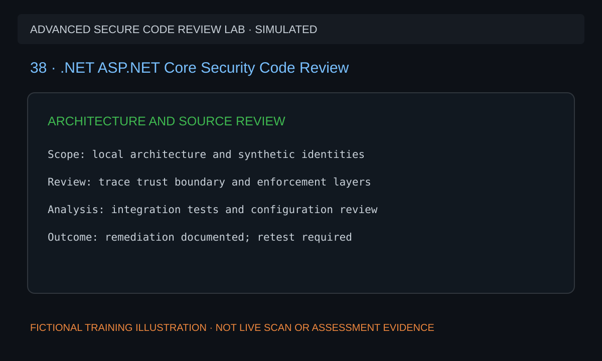
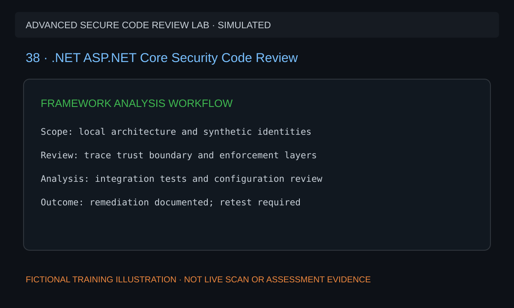
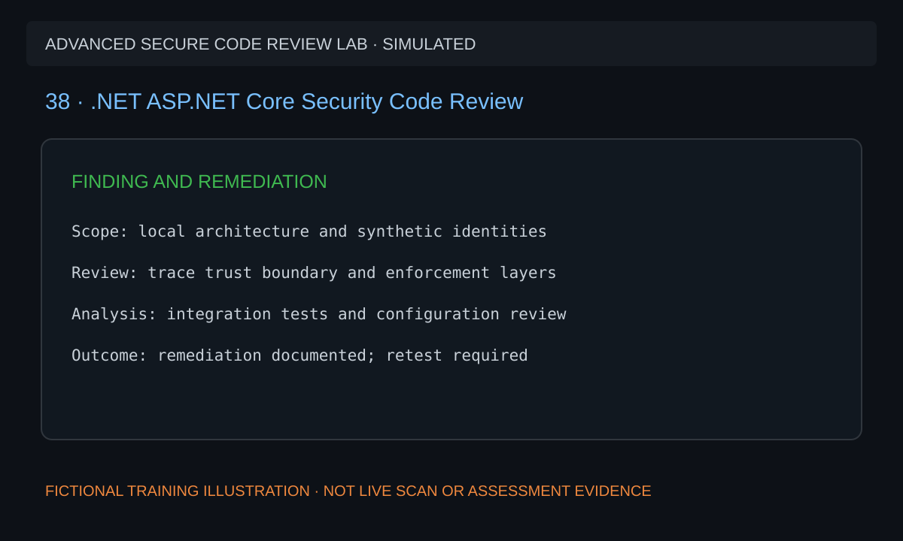

# Project 38: .NET ASP.NET Core Security Code Review

**Level:** Advanced  
**Focus:** ASP.NET Core  
**Status:** Detailed training walkthrough

## Objective
Conduct an advanced framework/architecture-aware code review of asp.net core, validating security boundaries across the complete execution path and producing testable remediation.

## Scope and authorization
Use a local training application, synthetic identities/data, and code you own or are authorized to review. No production or third-party testing without written authorization. Screenshots are simulated illustrations and are not real assessment evidence.

## Prerequisites
- Local framework-specific sample application
- Git, IDE, runtime, and dependency tooling
- SAST and framework-native test tooling
- Architecture/data-flow diagram and synthetic test identities
- Relevant framework security documentation

## Architecture and review approach
Use local ASP.NET Core fixture and synthetic users; trace endpoint metadata and model binding; test policy enforcement and over-posting; apply explicit policies/DTOs; add integration tests.

## Detailed review steps
1. Document components, trust boundaries, identities, data stores, and external dependencies.
2. Identify entry points and security policy enforcement points across framework layers.
3. Trace authentication, authorization, validation, and sensitive data handling end to end.
4. Inspect framework defaults, configuration overrides, error paths, background tasks, and alternate routes.
5. Build negative tests for missing/invalid identity, unauthorized action, and boundary-crossing attempts.
6. Validate candidate findings in the local fixture; document evidence and business impact.
7. Implement a defense-in-depth fix and review the full diff for regressions.

## Tools and commands
```bash
grep -RInE 'Authorize|AllowAnonymous|AddAuthentication|AddAuthorization|FromBody|Antiforgery|DataProtection' samples/
semgrep scan --config auto samples/
git diff --check
```

Use framework-native tests and static analysis together. A scanner result alone is not a confirmed finding.

## Expected results
A component/data-flow map, verified authorization and trust-boundary behavior, evidence-backed findings, regression tests, and a retest record.

## Finding and risk analysis
**Representative finding:** A controller action lacks the intended policy or binds sensitive model properties directly from client input.

**Mapping:** CWE-862; CWE-352; CWE-522; OWASP ASVS

Assess severity based on exposure, reachable attack path, privileges, data sensitivity, tenant boundaries, and business impact. Avoid unsupported CVE claims.

## Remediation
Use explicit authorization policies, validate bound models, antiforgery protections for browser forms, managed secrets, and supported data protection key management.

## Validation and retesting
1. Add integration tests for authenticated, unauthenticated, permitted, and denied flows.
2. Test edge cases and alternate entry points/background processing.
3. Re-run SAST and framework test suites.
4. Review effective configuration and the final diff.
5. Document residual risk and obtain technical owner sign-off.

## Evidence and reporting
Provide sanitized architecture diagrams, code references, test results, tool versions, severity rationale, remediation diff, and retest outcome. Never publish real tokens, personal data, customer source, or production configuration.

## Simulated screenshots
Fictional training mockups only; not actual IDE screenshots, scan output, or live assessment evidence.







## Deliverables
- Architecture and trust-boundary map
- Framework-specific review checklist
- Verified findings with CWE/OWASP mapping
- Remediation changes and regression tests
- Retest summary and technical sign-off
