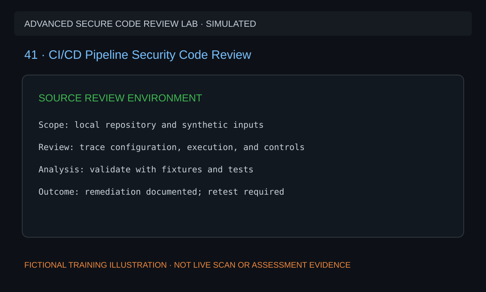
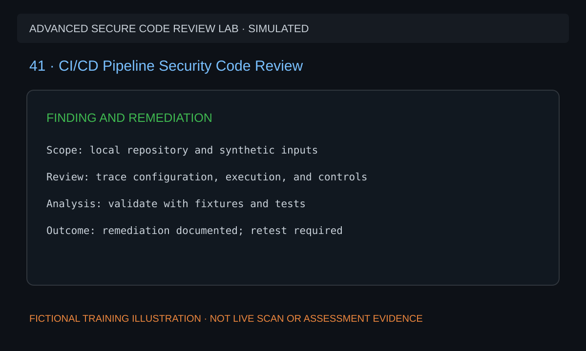

# Project 41: CI/CD Pipeline Security Code Review

**Level:** Advanced  
**Focus:** CI/CD security  
**Status:** Detailed training walkthrough

## Objective
Perform an advanced review of ci/cd security in a local source repository, verify the relevant controls, and document repeatable remediation and validation.

## Scope and authorization
Use only local training repositories, fictional code, and synthetic values. Do not scan production or third-party repositories without explicit written authorization. Screenshots are simulated illustrations, not real tool output or assessment evidence.

## Prerequisites
- Local sample repository and Git
- Relevant static-analysis/pipeline tooling
- Code editor and documented scope
- Synthetic secrets and test fixtures only
- Test harness and framework/tool documentation

## Review methodology
Use local sample workflow files only; inspect trigger context and permissions; trace secrets and artifacts; apply minimal token permissions and protected environments; validate with workflow lint and policy checks.

## Detailed review steps
1. Define in-scope files, execution contexts, trust boundaries, and exclusions.
2. Identify privileged operations, secrets, artifacts, and security decision points.
3. Trace untrusted inputs and permissions through the complete workflow or analysis lifecycle.
4. Review tool configuration and default behavior against vendor guidance.
5. Validate candidate findings with local fixtures and expected positive/negative cases.
6. Record affected file, execution path, impact, exploitability, and confidence.
7. Implement narrowly scoped remediation and test that security coverage is preserved.

## Tools and commands
```bash
grep -RInE 'pull_request_target|permissions:|secrets\.|workflow_dispatch|deploy|artifact' samples/
git diff --check
git status --short
```

Run tools against the local fixture only. Tool alerts and query matches require manual validation.

## Expected results
A documented workflow/rule/query/design review, validated findings, testable remediation, and reproducible evidence.

## Finding and risk analysis
**Representative finding:** Untrusted contribution code can execute in a privileged workflow context or access deployment secrets.

**Mapping:** CWE-250; CWE-829; OWASP A08:2021

Severity must reflect execution context, privileges, trust boundaries, affected assets, and business impact. Do not treat a tool alert as a confirmed vulnerability without evidence.

## Remediation
Use least-privileged workflow tokens, isolate untrusted builds, protect deployment environments, pin actions, and separate build from privileged release steps.

## Validation and retesting
1. Add positive and negative fixtures or policy tests.
2. Confirm privileged paths are protected and expected detections still occur.
3. Re-run the relevant linter, scanner, or query tests.
4. Inspect the final diff and document exceptions.
5. Record residual risk, tool versions, and reviewer sign-off.

## Evidence and reporting
Include sanitized workflow/configuration excerpts, query/rule tests, tool versions, validated output, severity rationale, remediation diff, and retest status. Do not publish secrets or proprietary source.

## Simulated screenshots
Fictional instructional mockups only; not actual IDE captures, pipeline logs, scanner output, or live assessment evidence.






## Deliverables
- Scope and review checklist
- Workflow/rule/query/design analysis
- Finding register with mappings and severity rationale
- Remediation and regression/policy tests
- Retest report and sign-off
