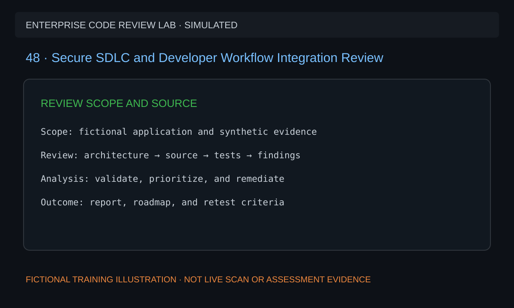
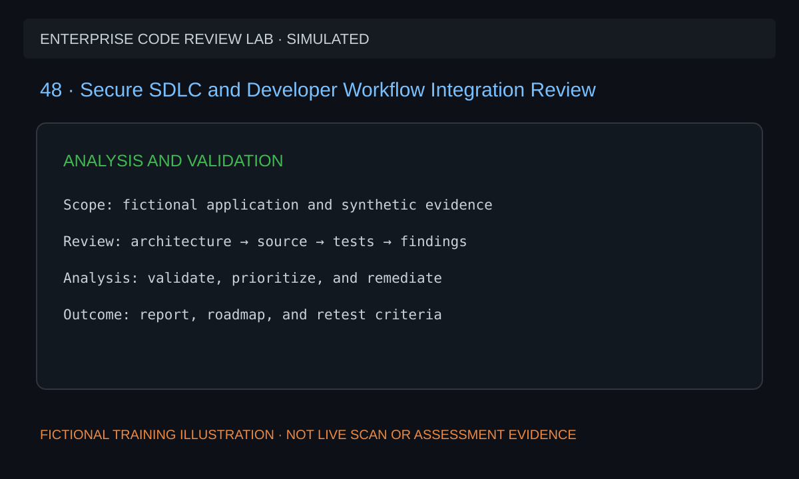
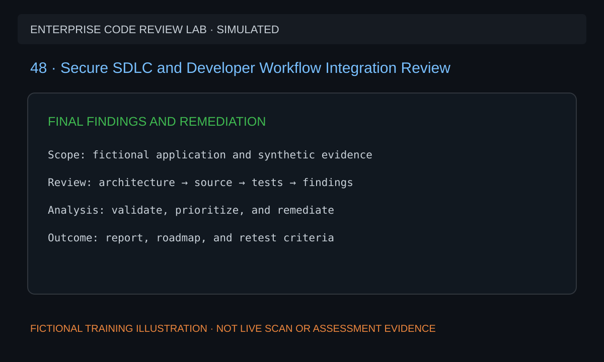

# Project 48: Secure SDLC and Developer Workflow Integration Review

**Level:** Advanced  
**Focus:** Secure SDLC  
**Status:** Detailed training walkthrough

## Objective
Complete an advanced secure sdlc exercise using a local fictional application, verify security controls with source-level evidence, and produce a defensible remediation and retest record.

## Scope and authorization
Use only fictional code, synthetic data, and repositories you own or are authorized to review. No production or third-party testing without written authorization. The screenshots are simulated training illustrations, not genuine assessment evidence.

## Prerequisites
- Local application repository and Git
- Code editor and relevant language runtime
- SAST, dependency, and configuration analysis tools as applicable
- Synthetic test identities/data and a test harness
- Documented scope, review criteria, and evidence handling

## Review methodology
Use local example workflow/config only; map commit-to-release gates; test required checks and exception handling; document ownership, SLAs, and audit evidence.

## Detailed review steps
1. Define application scope, architecture, technologies, trust boundaries, and exclusions.
2. Inventory entry points, sensitive data, privileged operations, and external dependencies.
3. Trace security controls from request entry through service/data layers and configuration.
4. Run applicable static, dependency, and configuration checks against local files.
5. Manually validate each candidate issue and test the relevant behavior in the fixture.
6. Prioritize confirmed findings using impact, exploitability, exposure, and business context.
7. Implement or recommend remediation, add regression tests, and verify the final diff.
8. Produce a report with clear limitations and retest criteria.

## Tools and commands
```bash
grep -RInE 'workflow|semgrep|codeql|osv|secret|approval|branch protection' .github/ samples/
```

Use tools only against the local training repository. A scan result is not proof until manually validated.

## Expected results
A documented scope and methodology, architecture/data-flow notes, evidence-backed findings or no-finding conclusions, prioritized remediation, and a repeatable retest plan.

## Finding and risk analysis
**Representative finding:** Security checks run inconsistently, can be bypassed without review, or fail without actionable owner/remediation records.

**Mapping:** NIST SSDF; OWASP SAMM

Severity must be justified with context and a consistent organizational risk method. Distinguish confirmed vulnerabilities, defense-in-depth recommendations, and accepted risks. Do not claim CVEs without verified affected components.

## Remediation
Integrate risk-based checks early, protect branches, require peer review, manage exceptions, and make security feedback actionable without exposing secrets.

## Validation and retesting
1. Define a test for each finding's security property.
2. Re-run the test after remediation and verify expected behavior.
3. Re-run relevant SAST/dependency/configuration checks.
4. Inspect the final code/configuration diff and check for regressions.
5. Record pass/fail/not-tested status, residual risk, and owner sign-off.

## Evidence and reporting
Maintain sanitized scope, methodology, code references, test output, tool versions, severity rationale, remediation roadmap, and retest status. Do not publish real customer code, credentials, personal data, or production evidence.

## Simulated screenshots
Fictional training illustrations only. They do not depict a real enterprise review, live tool execution, or actual client evidence.







## Deliverables
- Scope and methodology document
- Architecture/data-flow and review notes
- Finding register with evidence, severity, mapping, and owner
- Remediation roadmap and regression tests
- Retest matrix and final executive/technical report
