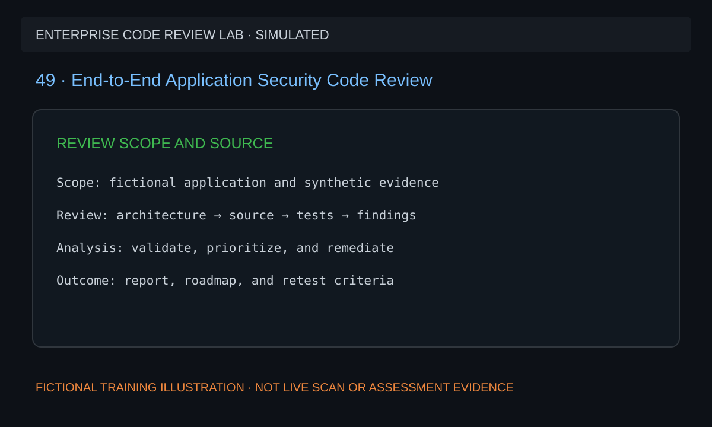
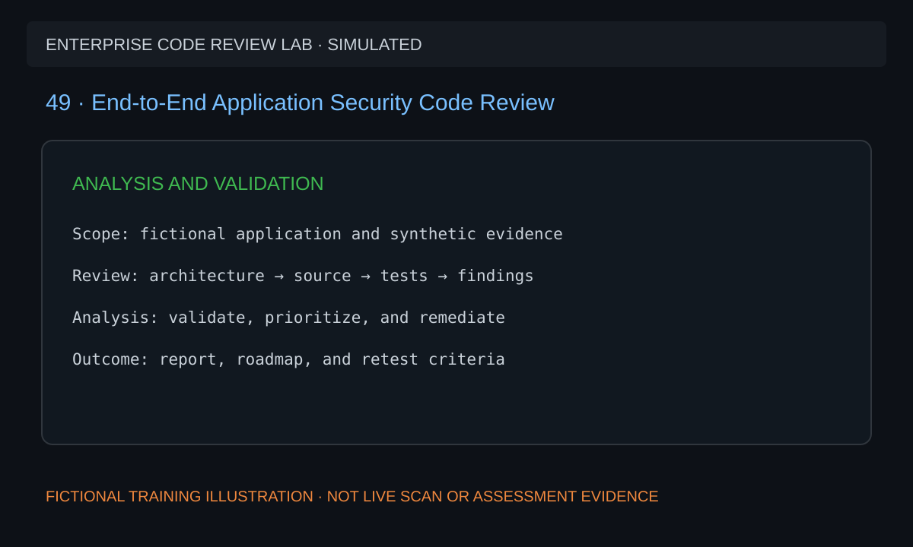
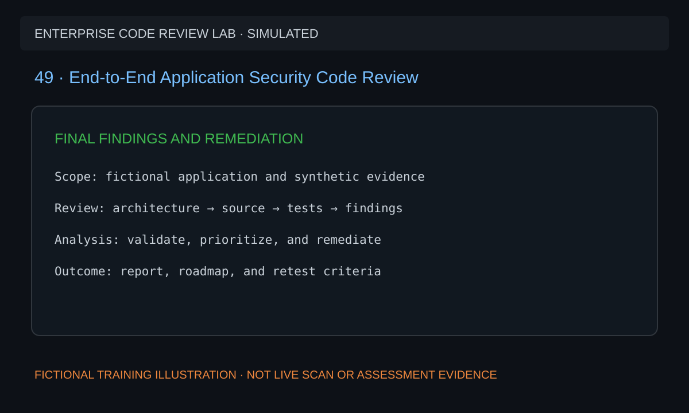

# Project 49: End-to-End Application Security Code Review

**Level:** Advanced  
**Focus:** End-to-end review  
**Status:** Detailed training walkthrough

## Objective
Complete an advanced end-to-end review exercise using a local fictional application, verify security controls with source-level evidence, and produce a defensible remediation and retest record.

## Scope and authorization
Use only fictional code, synthetic data, and repositories you own or are authorized to review. No production or third-party testing without written authorization. The screenshots are simulated training illustrations, not genuine assessment evidence.

## Prerequisites
- Local application repository and Git
- Code editor and relevant language runtime
- SAST, dependency, and configuration analysis tools as applicable
- Synthetic test identities/data and a test harness
- Documented scope, review criteria, and evidence handling

## Review methodology
Build a small local application fixture; map components and data flows; review auth, access control, input handling, dependencies, secrets, and configuration; validate findings and fixes; produce an executive and technical report.

## Detailed review steps
1. Define application scope, architecture, technologies, trust boundaries, and exclusions.
2. Inventory entry points, sensitive data, privileged operations, and external dependencies.
3. Trace security controls from request entry through service/data layers and configuration.
4. Run applicable static, dependency, and configuration checks against local files.
5. Manually validate each candidate issue and test the relevant behavior in the fixture.
6. Prioritize confirmed findings using impact, exploitability, exposure, and business context.
7. Implement or recommend remediation, add regression tests, and verify the final diff.
8. Produce a report with clear limitations and retest criteria.

## Tools and commands
```bash
find samples/ -type f -maxdepth 5 -print\nsemgrep scan --config auto samples/\ngit diff --check
```

Use tools only against the local training repository. A scan result is not proof until manually validated.

## Expected results
A documented scope and methodology, architecture/data-flow notes, evidence-backed findings or no-finding conclusions, prioritized remediation, and a repeatable retest plan.

## Finding and risk analysis
**Representative finding:** Individual findings are reviewed in isolation while systemic trust-boundary or cross-component weaknesses remain undetected.

**Mapping:** OWASP ASVS; NIST SSDF; CWE mapping per confirmed finding

Severity must be justified with context and a consistent organizational risk method. Distinguish confirmed vulnerabilities, defense-in-depth recommendations, and accepted risks. Do not claim CVEs without verified affected components.

## Remediation
Use a documented scope, threat model, manual review, SAST/dependency/config checks, risk triage, peer validation, and retest evidence.

## Validation and retesting
1. Define a test for each finding's security property.
2. Re-run the test after remediation and verify expected behavior.
3. Re-run relevant SAST/dependency/configuration checks.
4. Inspect the final code/configuration diff and check for regressions.
5. Record pass/fail/not-tested status, residual risk, and owner sign-off.

## Evidence and reporting
Maintain sanitized scope, methodology, code references, test output, tool versions, severity rationale, remediation roadmap, and retest status. Do not publish real customer code, credentials, personal data, or production evidence.

## Simulated screenshots
Fictional training illustrations only. They do not depict a real enterprise review, live tool execution, or actual client evidence.







## Deliverables
- Scope and methodology document
- Architecture/data-flow and review notes
- Finding register with evidence, severity, mapping, and owner
- Remediation roadmap and regression tests
- Retest matrix and final executive/technical report
