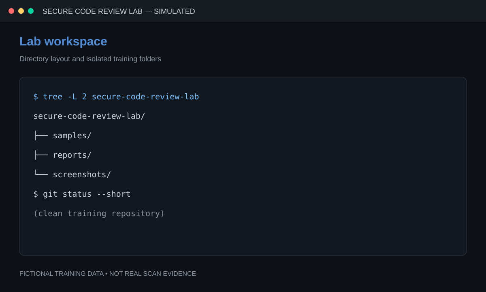
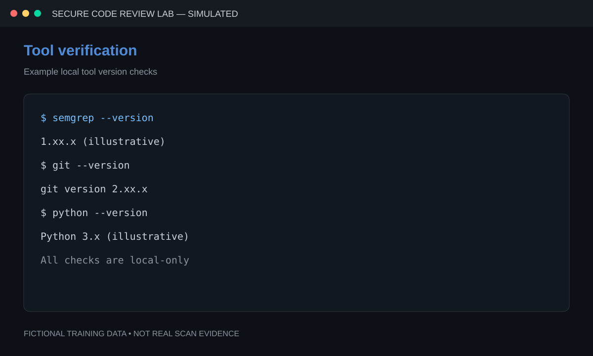
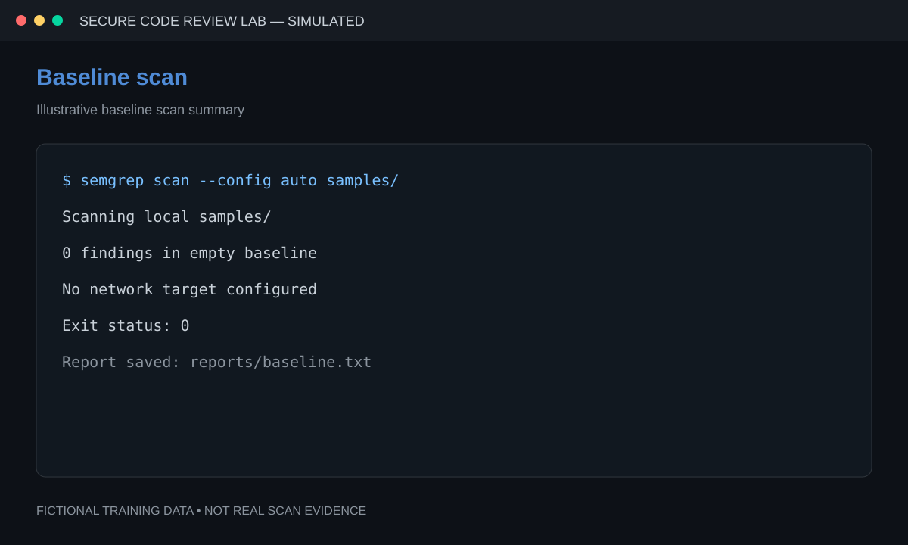

# Project 01: Secure Code Review Lab Setup

**Level:** Beginner  
**Language / focus:** General  
**Status:** Training walkthrough

## 1. Objective

Build a repeatable local environment for reviewing intentionally vulnerable training code without exposing real applications or secrets.

## 2. Scope and safety

Work only with the local, fictional sample code created for this exercise. Do not point scanners at production repositories or third-party systems without explicit authorization. Any screenshots in this README are simulated illustrations with fictional output, not genuine tool captures or assessment evidence.

## 3. Lab preparation

Create a workspace with separate folders for sample applications, scan output, notes, and reports. Use a disposable virtual environment or container for each language-specific exercise. Keep test data fictional.

### Suggested tools

- Git and a code editor
- Semgrep with the relevant language ruleset
- The language runtime or syntax checker, where applicable
- A notes file for source-to-sink traces and candidate findings

## 4. Review procedure

1. Create a dedicated directory named `secure-code-review-lab`.
2. Create `samples/`, `reports/`, and `screenshots/` subdirectories.
3. Install a code editor and Git.
4. Install Semgrep using its official installation instructions; verify with `semgrep --version`.
5. Install the language runtime needed for the sample project; verify the runtime version.
6. Create a small test repository and initialize Git with `git init`.
7. Add a README describing the lab boundary: local sample code only, no production credentials, and no third-party targets.
8. Run a baseline scan against the empty/sample repository and save output under `reports/`.
9. Confirm that scan output contains no real secrets or personal data.

## 5. Example commands

Run commands from the repository root and adjust paths to match your local fixture:

```bash
mkdir -p secure-code-review-lab/{samples,reports,screenshots}
cd secure-code-review-lab
git init
semgrep --version
semgrep scan --config auto samples/
```

Static-analysis matches are leads, not confirmed vulnerabilities. Review the code path, configuration, reachability, and runtime context before reporting a finding.

## 6. Findings and risk analysis

A lab is not ready if sample code, credentials, scan output, and reports are mixed together; if scans run against unintended directories; or if reports contain real secrets. Record these as setup defects and correct them before later exercises.

For each confirmed issue, record:
- Affected file and line or function
- Entry point and attacker-controlled source, if applicable
- Sensitive sink and missing or ineffective control
- Preconditions, impact, and confidence
- CWE / OWASP mapping where appropriate
- Reproduction notes using only the local fixture

## 7. Remediation

Use fictional credentials only, keep samples in a dedicated directory, exclude secrets and generated output from Git where appropriate, pin tool versions for repeatability, and document the approved scope.

## 8. Validation

Run the baseline scan again, verify the target path is exactly the local samples directory, inspect the report for accidental sensitive data, and confirm Git status contains only intended training files.

## 9. Simulated walkthrough screenshots

These images are generated mockups for instructional purposes. They do not depict a real scan, real source repository, or real assessment.

### Environment / source review


### Tool execution / analysis


### Results / remediation


## 10. Report template

| Field | Notes |
|---|---|
| Project | Secure Code Review Lab Setup |
| Scope | Local training fixture only |
| Finding | Describe the verified weakness, or state no issue confirmed |
| Evidence | File, line, source-to-sink trace, and test result |
| Severity | Justify using impact, exploitability, and preconditions |
| Remediation | Specific code or configuration change |
| Retest | Pass / fail / not tested, with reason |

## 11. Completion checklist

- [ ] Reviewed the complete relevant code path
- [ ] Identified sources, sinks, and security controls
- [ ] Distinguished scanner alerts from confirmed findings
- [ ] Documented evidence and risk rationale
- [ ] Applied a secure remediation
- [ ] Added or ran regression tests
- [ ] Re-ran analysis and reviewed the final diff

---

*Training material only. Keep all testing within authorized, isolated environments.*
