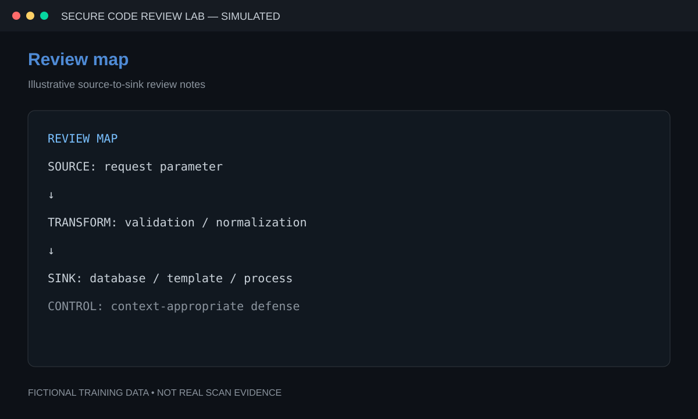
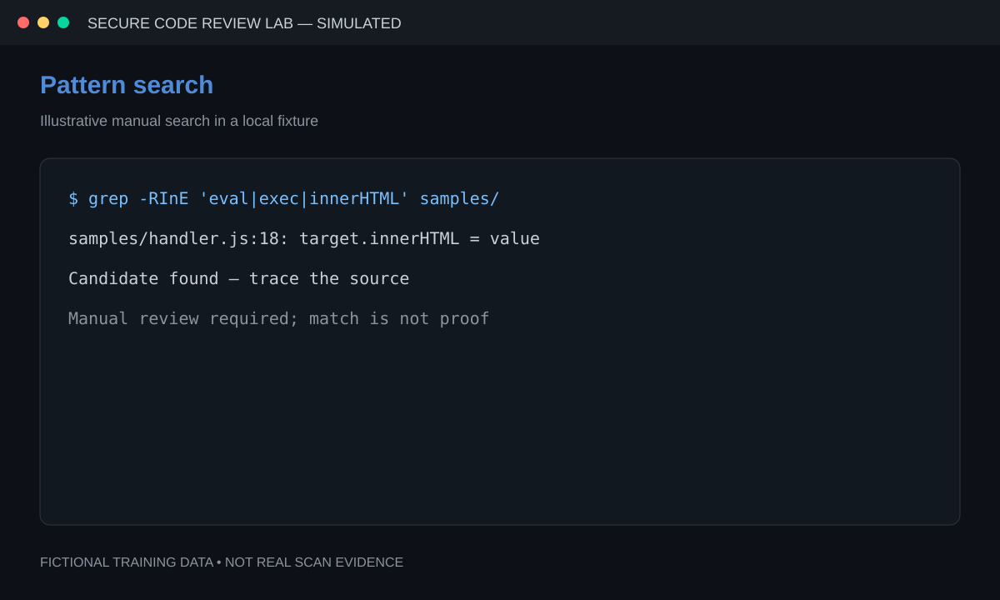
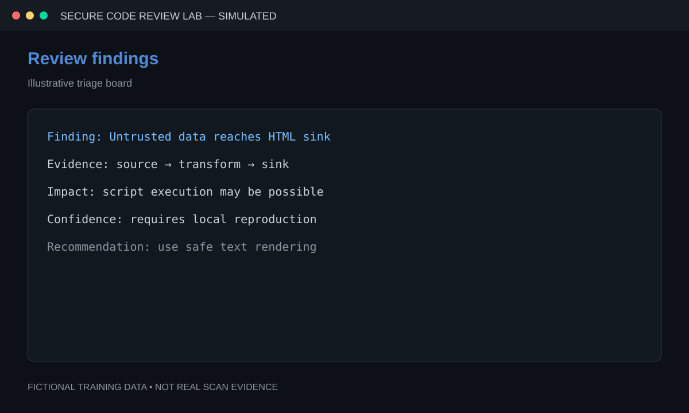

# Project 02: Source Code Security Review Fundamentals

**Level:** Beginner  
**Language / focus:** Language-agnostic  
**Status:** Training walkthrough

## 1. Objective

Practice a structured manual review using trust boundaries, entry points, sensitive operations, and data-flow tracing.

## 2. Scope and safety

Work only with the local, fictional sample code created for this exercise. Do not point scanners at production repositories or third-party systems without explicit authorization. Any screenshots in this README are simulated illustrations with fictional output, not genuine tool captures or assessment evidence.

## 3. Lab preparation

Use a small fictional web handler with an HTTP parameter, a validation step, a database call, and an output response. The exercise is about tracing data, not exploiting a live service.

### Suggested tools

- Git and a code editor
- Semgrep with the relevant language ruleset
- The language runtime or syntax checker, where applicable
- A notes file for source-to-sink traces and candidate findings

## 4. Review procedure

1. Identify the application's purpose, framework, entry points, and trust boundaries.
2. List user-controlled sources: request parameters, headers, cookies, uploaded files, and message payloads.
3. Identify sensitive sinks: database queries, shell/process calls, file paths, template rendering, redirects, and authorization decisions.
4. Trace each source to each sink and note transformations or validation.
5. Review authentication and authorization separately; being logged in does not prove access to a specific object.
6. Check error handling, logging, secrets, dependencies, and security configuration.
7. Record each candidate issue with location, source-to-sink path, impact, preconditions, and confidence.
8. Reproduce only in the local training fixture, then validate the proposed fix.

## 5. Example commands

Run commands from the repository root and adjust paths to match your local fixture:

```bash
# Search for common high-risk operations (adapt patterns to the language)
grep -RInE 'eval\(|exec\(|system\(|SELECT .*\+|innerHTML|deserialize' samples/
# Review tracked files and changes
git status --short
git diff --
```

Static-analysis matches are leads, not confirmed vulnerabilities. Review the code path, configuration, reachability, and runtime context before reporting a finding.

## 6. Findings and risk analysis

A common review failure is searching only for dangerous function names. A secure review must establish whether attacker-controlled data can reach a sensitive operation and whether the control is appropriate for that context.

For each confirmed issue, record:
- Affected file and line or function
- Entry point and attacker-controlled source, if applicable
- Sensitive sink and missing or ineffective control
- Preconditions, impact, and confidence
- CWE / OWASP mapping where appropriate
- Reproduction notes using only the local fixture

## 7. Remediation

Use a consistent checklist and data-flow notes. Validate at the boundary, use context-appropriate safe APIs at the sink, and enforce authorization on the server for every protected object or action.

## 8. Validation

Have a second reviewer follow the recorded source-to-sink path. Confirm the control is applied before the sensitive operation and add a regression test that demonstrates the unsafe behavior is no longer possible.

## 9. Simulated walkthrough screenshots

These images are generated mockups for instructional purposes. They do not depict a real scan, real source repository, or real assessment.

### Environment / source review


### Tool execution / analysis


### Results / remediation


## 10. Report template

| Field | Notes |
|---|---|
| Project | Source Code Security Review Fundamentals |
| Scope | Local training fixture only |
| Finding | Describe the verified weakness, or state no issue confirmed |
| Evidence | File, line, source-to-sink trace, and test result |
| Severity | Justify using impact, exploitability, and preconditions |
| Remediation | Specific code or configuration change |
| Retest | Pass / fail / not tested, with reason |

## 11. Completion checklist

- [ ] Reviewed the complete relevant code path
- [ ] Identified sources, sinks, and security controls
- [ ] Distinguished scanner alerts from confirmed findings
- [ ] Documented evidence and risk rationale
- [ ] Applied a secure remediation
- [ ] Added or ran regression tests
- [ ] Re-ran analysis and reviewed the final diff

---

*Training material only. Keep all testing within authorized, isolated environments.*
