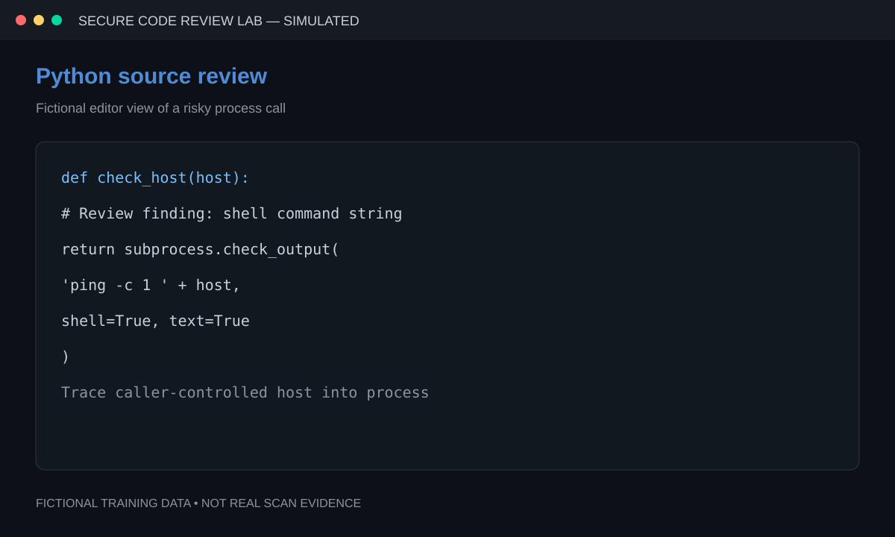
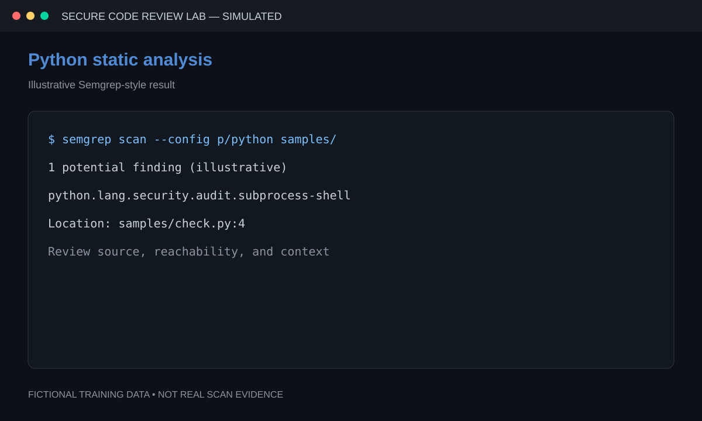
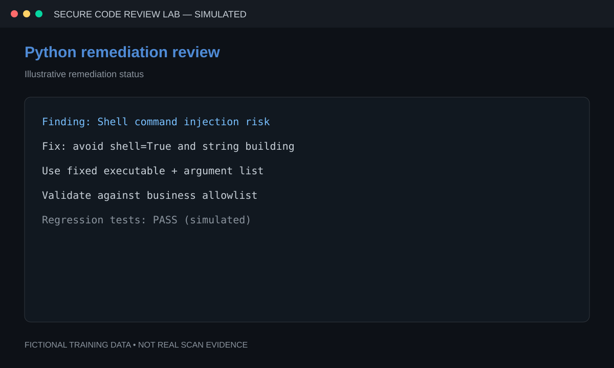

# Project 03: Python Code Security Review

**Level:** Beginner  
**Language / focus:** Python  
**Status:** Training walkthrough

## 1. Objective

Review a small Python service for unsafe command execution, weak input handling, and exposed configuration, then replace risky patterns with safer APIs.

## 2. Scope and safety

Work only with the local, fictional sample code created for this exercise. Do not point scanners at production repositories or third-party systems without explicit authorization. Any screenshots in this README are simulated illustrations with fictional output, not genuine tool captures or assessment evidence.

## 3. Lab preparation

Create a local-only Python fixture. Example of a risky pattern for review:

```python
import subprocess

def check_host(host):
    # Training-only anti-pattern: user input is concatenated into a shell command.
    return subprocess.check_output("ping -c 1 " + host, shell=True, text=True)
```

Safer direction: avoid invoking a shell, validate the input against the application's actual business requirement, and pass arguments as a list. For this exercise, do not send traffic to external hosts; use a mocked function or a loopback-only test.

### Suggested tools

- Git and a code editor
- Semgrep with the relevant language ruleset
- The language runtime or syntax checker, where applicable
- A notes file for source-to-sink traces and candidate findings

## 4. Review procedure

1. Identify request or function parameters that can be influenced by a caller.
2. Search for `subprocess`, `os.system`, `eval`, `pickle.loads`, unsafe YAML loading, and dynamic SQL construction.
3. Trace the `host` value from the function boundary to the process invocation.
4. Explain why `shell=True` combined with string concatenation is dangerous.
5. Replace shell-string execution with an argument list and an allowlist appropriate to the app; prefer a mock for the lab.
6. Review configuration loading and ensure secrets come from a secret store or environment injection, not committed source.
7. Add unit tests for valid and invalid inputs and inspect the final diff.

## 5. Example commands

Run commands from the repository root and adjust paths to match your local fixture:

```bash
python -m venv .venv
. .venv/bin/activate
python -m pip install --upgrade pip
semgrep scan --config p/python samples/
python -m compileall samples/
```

Static-analysis matches are leads, not confirmed vulnerabilities. Review the code path, configuration, reachability, and runtime context before reporting a finding.

## 6. Findings and risk analysis

Potential command injection: untrusted input is concatenated into a shell command executed with shell interpretation enabled. Severity depends on reachability, execution context, privileges, and the application's actual input constraints.

For each confirmed issue, record:
- Affected file and line or function
- Entry point and attacker-controlled source, if applicable
- Sensitive sink and missing or ineffective control
- Preconditions, impact, and confidence
- CWE / OWASP mapping where appropriate
- Reproduction notes using only the local fixture

## 7. Remediation

Avoid shell interpretation. Use a fixed executable with a list of arguments, validate input against a strict business allowlist, apply least privilege, and mock process execution in unit tests.

## 8. Validation

Unit-test the function with ordinary, malformed, and shell-metacharacter-containing strings while mocking the process call. Assert that no shell is invoked and that invalid values are rejected. Re-run Semgrep and manually inspect the changed data flow.

## 9. Simulated walkthrough screenshots

These images are generated mockups for instructional purposes. They do not depict a real scan, real source repository, or real assessment.

### Environment / source review


### Tool execution / analysis


### Results / remediation


## 10. Report template

| Field | Notes |
|---|---|
| Project | Python Code Security Review |
| Scope | Local training fixture only |
| Finding | Describe the verified weakness, or state no issue confirmed |
| Evidence | File, line, source-to-sink trace, and test result |
| Severity | Justify using impact, exploitability, and preconditions |
| Remediation | Specific code or configuration change |
| Retest | Pass / fail / not tested, with reason |

## 11. Completion checklist

- [ ] Reviewed the complete relevant code path
- [ ] Identified sources, sinks, and security controls
- [ ] Distinguished scanner alerts from confirmed findings
- [ ] Documented evidence and risk rationale
- [ ] Applied a secure remediation
- [ ] Added or ran regression tests
- [ ] Re-ran analysis and reviewed the final diff

---

*Training material only. Keep all testing within authorized, isolated environments.*
