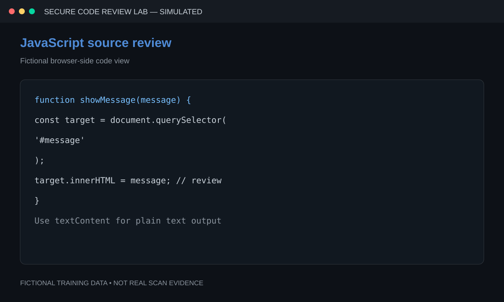
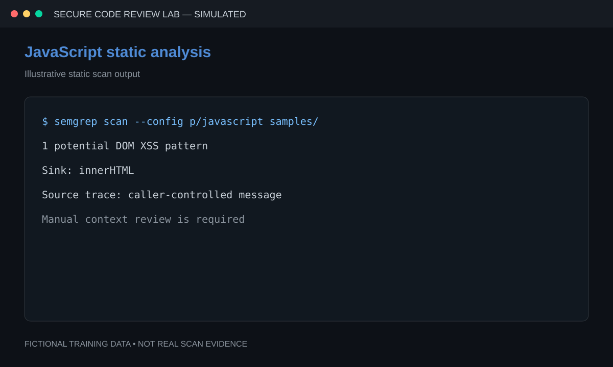
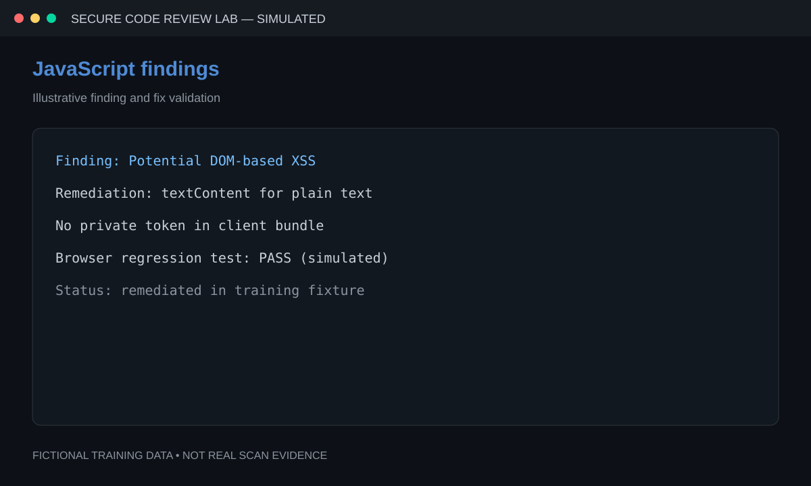

# Project 04: JavaScript Code Security Review

**Level:** Beginner  
**Language / focus:** JavaScript  
**Status:** Training walkthrough

## 1. Objective

Review DOM and server-side JavaScript patterns, focusing on unsafe HTML insertion, validation, and secret exposure.

## 2. Scope and safety

Work only with the local, fictional sample code created for this exercise. Do not point scanners at production repositories or third-party systems without explicit authorization. Any screenshots in this README are simulated illustrations with fictional output, not genuine tool captures or assessment evidence.

## 3. Lab preparation

Use a local HTML page and a tiny JavaScript module. Training-only anti-pattern:

```javascript
function showMessage(message) {
  document.querySelector("#message").innerHTML = message;
}
```

Safer direction: render plain text with `textContent`. If rich HTML is a real requirement, use a vetted sanitizer with a carefully defined policy and test it.

### Suggested tools

- Git and a code editor
- Semgrep with the relevant language ruleset
- The language runtime or syntax checker, where applicable
- A notes file for source-to-sink traces and candidate findings

## 4. Review procedure

1. Identify untrusted sources such as URL parameters, form fields, API responses, and browser storage.
2. Search for `innerHTML`, `outerHTML`, `insertAdjacentHTML`, `document.write`, `eval`, and dynamic script construction.
3. Trace each source into DOM or server-side output sinks.
4. Replace plain-text rendering with `textContent` or safe framework bindings.
5. Review server routes for authorization checks and parameterized database access.
6. Check that API keys and private tokens are not embedded in client bundles.
7. Add regression tests and review the diff.

## 5. Example commands

Run commands from the repository root and adjust paths to match your local fixture:

```bash
# Search source files for risky DOM and dynamic-code patterns
grep -RInE 'innerHTML|outerHTML|insertAdjacentHTML|document\.write|eval\(' samples/
# If package scripts are present
npm audit
semgrep scan --config p/javascript samples/
```

Static-analysis matches are leads, not confirmed vulnerabilities. Review the code path, configuration, reachability, and runtime context before reporting a finding.

## 6. Findings and risk analysis

Potential DOM-based cross-site scripting: a value that may be controlled by a user is inserted as HTML. The issue is context-dependent; establish the source, transformations, sink, and page context before assigning severity.

For each confirmed issue, record:
- Affected file and line or function
- Entry point and attacker-controlled source, if applicable
- Sensitive sink and missing or ineffective control
- Preconditions, impact, and confidence
- CWE / OWASP mapping where appropriate
- Reproduction notes using only the local fixture

## 7. Remediation

Use `textContent` for text, safe framework output bindings, and a vetted sanitizer only when HTML rendering is required. Keep secrets on the server and enforce authorization in server-side routes.

## 8. Validation

Add a browser test with harmless markup-like strings and verify they render as text rather than being interpreted as elements. Re-run static analysis and confirm the client bundle contains no private credentials.

## 9. Simulated walkthrough screenshots

These images are generated mockups for instructional purposes. They do not depict a real scan, real source repository, or real assessment.

### Environment / source review


### Tool execution / analysis


### Results / remediation


## 10. Report template

| Field | Notes |
|---|---|
| Project | JavaScript Code Security Review |
| Scope | Local training fixture only |
| Finding | Describe the verified weakness, or state no issue confirmed |
| Evidence | File, line, source-to-sink trace, and test result |
| Severity | Justify using impact, exploitability, and preconditions |
| Remediation | Specific code or configuration change |
| Retest | Pass / fail / not tested, with reason |

## 11. Completion checklist

- [ ] Reviewed the complete relevant code path
- [ ] Identified sources, sinks, and security controls
- [ ] Distinguished scanner alerts from confirmed findings
- [ ] Documented evidence and risk rationale
- [ ] Applied a secure remediation
- [ ] Added or ran regression tests
- [ ] Re-ran analysis and reviewed the final diff

---

*Training material only. Keep all testing within authorized, isolated environments.*
