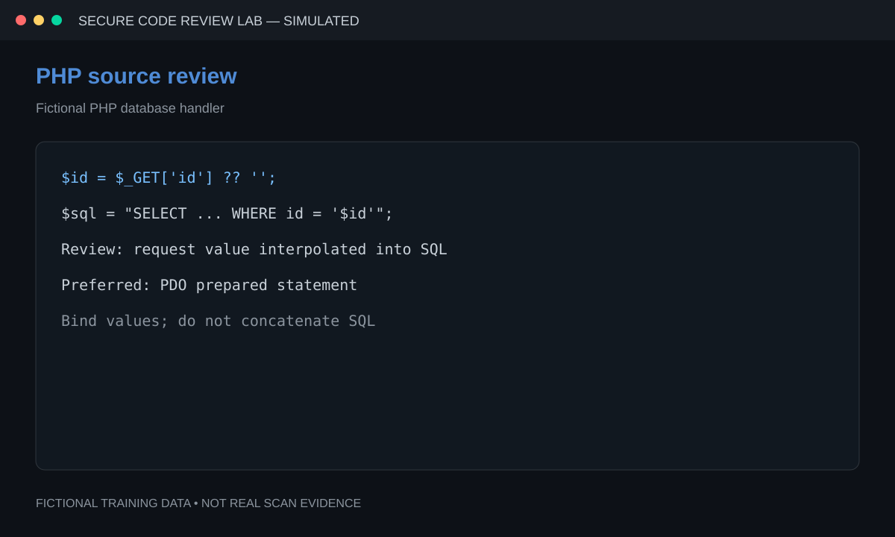
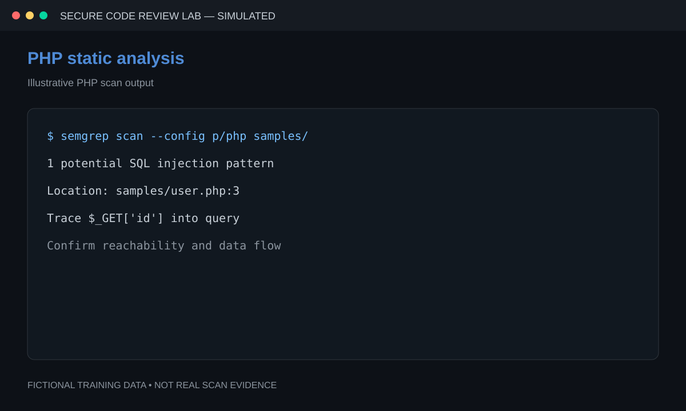
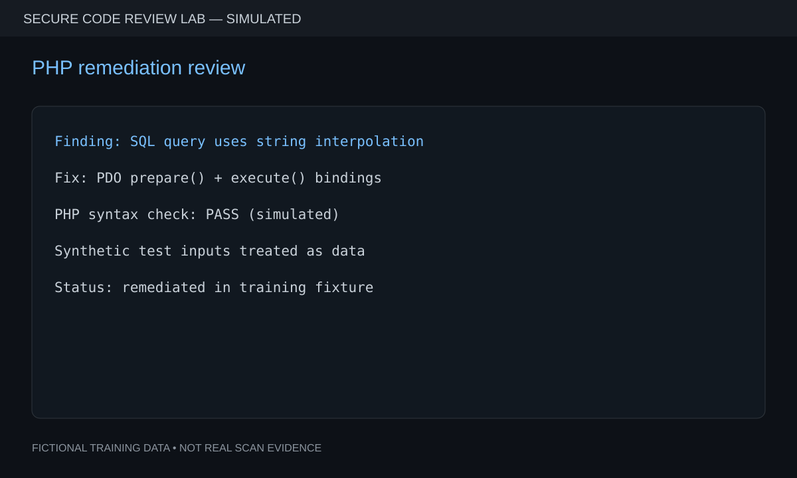

# Project 05: PHP Code Security Review

**Level:** Beginner  
**Language / focus:** PHP  
**Status:** Training walkthrough

## 1. Objective

Review PHP request handling and database access for unsafe SQL construction, output encoding gaps, and insecure configuration.

## 2. Scope and safety

Work only with the local, fictional sample code created for this exercise. Do not point scanners at production repositories or third-party systems without explicit authorization. Any screenshots in this README are simulated illustrations with fictional output, not genuine tool captures or assessment evidence.

## 3. Lab preparation

Create a local-only PHP fixture. Training-only anti-pattern:

```php
<?php
$id = $_GET['id'] ?? '';
$sql = "SELECT username FROM users WHERE id = '$id'";
```

Safer direction: validate the identifier according to the application's data model and use PDO prepared statements with bound parameters. Do not connect the fixture to a real database or real user data.

### Suggested tools

- Git and a code editor
- Semgrep with the relevant language ruleset
- The language runtime or syntax checker, where applicable
- A notes file for source-to-sink traces and candidate findings

## 4. Review procedure

1. Identify request sources such as `$_GET`, `$_POST`, `$_COOKIE`, `$_FILES`, and request headers.
2. Search for SQL string concatenation, `mysqli_query`, dynamic includes, unsafe file operations, and unescaped output.
3. Trace request values into SQL, HTML, file paths, and redirects.
4. Replace SQL construction with PDO prepared statements and bound parameters.
5. Encode output for its actual HTML context; do not treat input filtering as a replacement for output encoding.
6. Review upload handling, file permissions, error display, and secret storage.
7. Add tests for valid and malformed values, then inspect the patch.

## 5. Example commands

Run commands from the repository root and adjust paths to match your local fixture:

```bash
# Inspect common PHP risk patterns
grep -RInE '\$_(GET|POST|REQUEST|COOKIE|FILES)|mysqli_query|mysql_query|include\(|require\(' samples/
# Run PHP syntax checks where PHP is installed
find samples/ -name '*.php' -print0 | xargs -0 -r -n1 php -l
semgrep scan --config p/php samples/
```

Static-analysis matches are leads, not confirmed vulnerabilities. Review the code path, configuration, reachability, and runtime context before reporting a finding.

## 6. Findings and risk analysis

Potential SQL injection: a request parameter is interpolated directly into a SQL statement. Confirm whether the query is reachable and whether any upstream control is reliable; parameterized queries are the appropriate primary defense.

For each confirmed issue, record:
- Affected file and line or function
- Entry point and attacker-controlled source, if applicable
- Sensitive sink and missing or ineffective control
- Preconditions, impact, and confidence
- CWE / OWASP mapping where appropriate
- Reproduction notes using only the local fixture

## 7. Remediation

Use PDO prepared statements and bound parameters. Validate identifiers and business constraints, encode output at the rendering context, disable verbose production errors, and keep database credentials outside source control.

## 8. Validation

Use a test database with synthetic records or a mocked repository. Verify that quote characters and SQL-like input are treated as data, not query syntax. Run PHP lint and static analysis, then review the final diff.

## 9. Simulated walkthrough screenshots

These images are generated mockups for instructional purposes. They do not depict a real scan, real source repository, or real assessment.

### Environment / source review


### Tool execution / analysis


### Results / remediation


## 10. Report template

| Field | Notes |
|---|---|
| Project | PHP Code Security Review |
| Scope | Local training fixture only |
| Finding | Describe the verified weakness, or state no issue confirmed |
| Evidence | File, line, source-to-sink trace, and test result |
| Severity | Justify using impact, exploitability, and preconditions |
| Remediation | Specific code or configuration change |
| Retest | Pass / fail / not tested, with reason |

## 11. Completion checklist

- [ ] Reviewed the complete relevant code path
- [ ] Identified sources, sinks, and security controls
- [ ] Distinguished scanner alerts from confirmed findings
- [ ] Documented evidence and risk rationale
- [ ] Applied a secure remediation
- [ ] Added or ran regression tests
- [ ] Re-ran analysis and reviewed the final diff

---

*Training material only. Keep all testing within authorized, isolated environments.*
