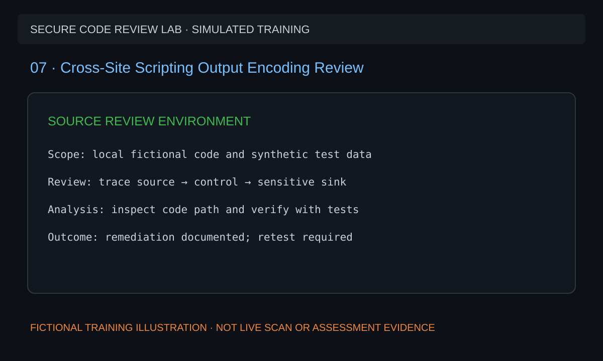
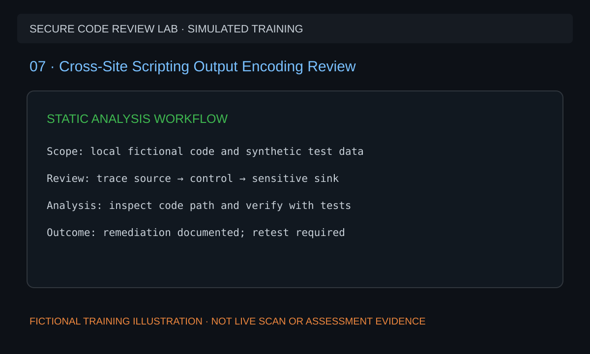

# Project 07: Cross-Site Scripting Output Encoding Review

**Level:** Beginner  
**Focus:** Cross-site scripting  
**Status:** Detailed training walkthrough

## Objective
Perform a focused manual secure code review, trace untrusted data and security decisions through the relevant code path, confirm the weakness in a local fixture, and validate a safe remediation.

## Scope and authorization
Use only fictional sample code, synthetic data, and repositories you own or are authorized to review. Do not scan or test third-party or production systems without written authorization. Screenshots are simulated training illustrations, not genuine tool output or assessment evidence.

## Prerequisites
- Git repository containing a small local training fixture
- Code editor and the relevant language runtime
- Semgrep or another approved SAST tool
- Test harness with synthetic data
- Notes for source-to-sink tracing and evidence

## Review methodology
Use a local page and harmless markup-like strings; map source-to-sink paths; review template auto-escaping and bypasses; replace unsafe sinks; add browser tests that assert content renders as text.

## Manual review steps
1. Identify the feature, trust boundaries, entry points, and security assumptions.
2. Locate sources, transformations, sensitive sinks, and enforcement controls.
3. Trace the complete path, including helper functions, framework middleware, configuration, and error handling.
4. Review the implementation against the expected security property: Cross-site scripting.
5. Reproduce only against the local fixture with synthetic values; distinguish scanner alerts from confirmed defects.
6. Document file/function, source-to-sink path, preconditions, impact, and confidence.
7. Apply the remediation and inspect the final diff for regressions or alternate unsafe paths.

## Tooling and commands
Suggested read-only search for review leads:

```bash
grep -RInE 'innerHTML|outerHTML|document\.write|dangerouslySetInnerHTML|v-html' samples/
semgrep scan --config auto samples/
git diff --check
git status --short
```

Search results are leads, not proof. Confirm reachability, framework behavior, runtime configuration, and the complete data flow manually.

## Expected results
A documented source-to-sink or control-flow trace, a confirmed finding or evidence-based no-finding result, and a tested remediation with a regression test.

## Finding and risk analysis
**Representative finding:** Untrusted input is rendered as executable markup or script in a browser context.

**Mapping:** CWE-79; OWASP A03:2021 Injection

Severity must reflect reachability, required privileges, exploitability, data sensitivity, business impact, and compensating controls. Do not assign a CVE to a code pattern without a verified affected product/version.

## Remediation
Use safe text APIs and framework auto-escaping; apply vetted sanitization only where rich HTML is required; validate by output context.

## Validation and retesting
1. Add tests for expected valid behavior and relevant negative/boundary cases.
2. Confirm the unsafe path is no longer reachable or the required control is enforced.
3. Re-run SAST and manually inspect any remaining matches.
4. Run the focused test suite and review the final diff.
5. Record residual risk, limitations, and reviewer sign-off.

## Evidence and reporting
Capture the affected file/function, sanitized code excerpt, data-flow diagram or notes, tool version/configuration, test result, severity rationale, and remediation diff. Never include real credentials, personal data, or production source code in public training evidence.

## Simulated screenshots
The following SVGs are fictional instructional mockups. They are not real editor captures, scanner output, or proof of a live assessment.






## Deliverables
- Scope and review checklist
- Source-to-sink/control-flow notes
- Finding with CWE/OWASP mapping and severity rationale
- Secure code change and regression tests
- Retest result and concise review report
