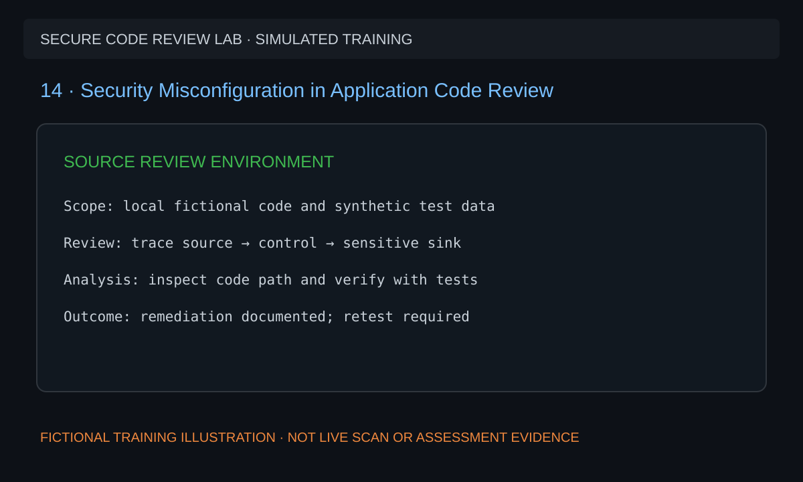

# Project 14: Security Misconfiguration in Application Code Review

**Level:** Beginner  
**Focus:** Application configuration  
**Status:** Detailed training walkthrough

## Objective
Perform a focused manual secure code review, trace the relevant input and control paths, confirm weaknesses in a local fixture, and validate secure remediation.

## Scope and authorization
Use fictional sample code and synthetic data in a repository you own or are authorized to review. Do not test production or third-party systems without written authorization. Screenshots are simulated training illustrations, not genuine tool output or assessment evidence.

## Prerequisites
- Git repository with a small local training fixture
- Code editor and relevant language runtime
- Semgrep or another approved SAST tool
- Synthetic test data and a local test harness
- Notes for source-to-sink tracing and evidence

## Review methodology
Use synthetic configuration files; compare development and production profiles; inspect effective configuration rather than only source defaults; validate CORS, cookie flags, and headers in a local test harness; add automated configuration assertions.

## Manual review steps
1. Identify the feature, trust boundaries, entry points, and security assumptions.
2. Locate user-controlled sources, transformations, sensitive sinks, and enforcement controls.
3. Trace the complete path, including helper functions, middleware, configuration, and error handling.
4. Compare implementation behavior with the intended security requirement.
5. Reproduce only against the local fixture with synthetic values; distinguish scanner alerts from confirmed defects.
6. Record file/function, data-flow path, preconditions, impact, and confidence.
7. Apply remediation and inspect the final diff for alternate unsafe paths.

## Tooling and commands
Suggested read-only review commands:

```bash
grep -RInE 'DEBUG|CORS|Access-Control-Allow-Origin|httpOnly|secure:|sameSite|X-Frame-Options|Content-Security-Policy' samples/
semgrep scan --config auto samples/
git diff --check
git status --short
```

Search results are leads, not proof. Confirm reachability, framework behavior, runtime configuration, and complete data flow manually.

## Expected results
A documented review trace, a confirmed finding or evidence-based no-finding result, and a tested remediation with regression coverage.

## Finding and risk analysis
**Representative finding:** Permissive defaults or debug configuration remain enabled in production-like configuration, weakening browser or application protections.

**Mapping:** CWE-16; CWE-693; OWASP A05:2021 Security Misconfiguration

Severity must reflect reachability, privileges, exploitability, data sensitivity, business impact, and compensating controls. Do not assign a CVE to a generic code pattern without a verified affected product/version.

## Remediation
Use secure framework defaults, explicit environment-specific configuration, narrow CORS origins, secure cookie attributes, and documented header policy.

## Validation and retesting
1. Add tests for valid behavior and relevant negative/boundary cases.
2. Confirm the unsafe path is no longer reachable or the required control is enforced.
3. Re-run SAST and manually triage remaining matches.
4. Run the focused test suite and inspect the final diff.
5. Record residual risk, limitations, and reviewer sign-off.

## Evidence and reporting
Capture affected file/function, sanitized code excerpt, source-to-sink notes, tool version/configuration, test results, severity rationale, and remediation diff. Never publish real credentials, personal data, or production source code.

## Simulated screenshots
These SVGs are fictional instructional mockups. They are not real editor captures, scanner output, or evidence of a live assessment.




## Deliverables
- Scope and review checklist
- Source-to-sink/control-flow notes
- Finding with CWE/OWASP mapping and severity rationale
- Secure code change and regression tests
- Retest result and concise review report
