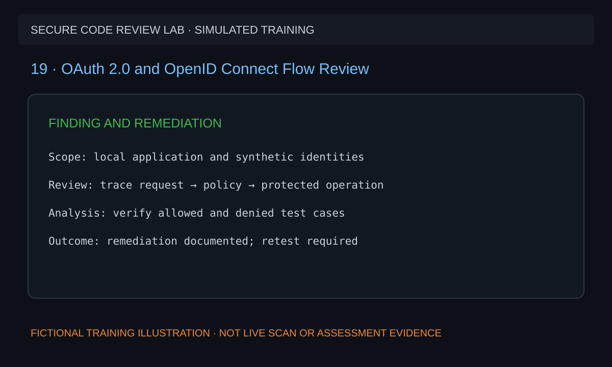

# Project 19: OAuth 2.0 and OpenID Connect Flow Review

**Level:** Intermediate  
**Focus:** OAuth/OIDC  
**Status:** Detailed training walkthrough

## Objective
Perform a focused secure code review of oauth/oidc, tracing control flow and trust boundaries, validating the behavior in a local fixture, and testing a secure remediation.

## Scope and authorization
Use fictional sample code, synthetic identities, and a repository you own or are authorized to review. Do not test third-party or production systems without written authorization. All screenshots are simulated training illustrations, not genuine tool output or assessment evidence.

## Prerequisites
- Local application fixture with synthetic data
- Git, code editor, and relevant language runtime
- Semgrep or an approved SAST tool
- Unit/integration test harness
- Framework/library security documentation

## Review methodology
Review a local mock provider/client flow; trace authorize request through callback and token exchange; inspect redirect matching and PKCE; add negative tests for state mismatch, nonce mismatch, and unregistered redirect.

## Detailed review steps
1. Identify entry points, trust boundaries, security principals, and sensitive operations.
2. Trace untrusted values and security decisions through routes, middleware, service layers, data access, and configuration.
3. Verify the security control is enforced server-side and fails closed.
4. Inspect edge cases, error paths, alternate routes, background tasks, and framework defaults.
5. Reproduce only in the local fixture with synthetic data and controlled test cases.
6. Record file/function, relevant code path, preconditions, impact, and confidence.
7. Implement the fix and inspect the final diff for bypasses or regressions.

## Tools and commands
Read-only search examples:

```bash
grep -RInE 'redirect_uri|state|nonce|code_verifier|code_challenge|scope|client_secret' samples/
semgrep scan --config auto samples/
git diff --check
```

Static-analysis alerts are leads. Confirm actual reachability, library semantics, effective configuration, and runtime behavior.

## Expected results
A complete control-flow trace, tested positive and negative cases, a confirmed finding or evidence-based no-finding result, and documented remediation.

## Finding and risk analysis
**Representative finding:** OAuth callback or authorization flow omits state/nonce validation, weakens PKCE, or accepts overly broad redirects/scopes.

**Mapping:** CWE-601; CWE-352; OWASP ASVS V2/V3

Assess severity using exploitability, privileges, affected data/actions, business impact, and compensating controls. Do not claim a CVE without a verified vulnerable dependency/product version.

## Remediation
Use exact registered redirect URIs, state and nonce validation, PKCE for public clients, minimal scopes, secure token storage, and vetted protocol libraries.

## Validation and retesting
1. Add regression tests for allowed and denied scenarios.
2. Test boundary conditions and alternate routes or code paths.
3. Re-run SAST and manually review residual matches.
4. Run the relevant unit/integration tests and inspect the patch.
5. Record residual risk, assumptions, and reviewer sign-off.

## Evidence and reporting
Include sanitized source excerpts, flow diagrams, test cases/results, tool versions, severity rationale, remediation diff, and retest status. Use only fictional identities and data; never publish tokens, secrets, or production source.

## Simulated screenshots
These SVGs are fictional training mockups, not real application screenshots, scanner output, or proof of a live assessment.




## Deliverables
- Scope and review checklist
- Security control/data-flow notes
- Finding with CWE/OWASP mapping and severity rationale
- Secure code change and regression tests
- Retest results and concise report
