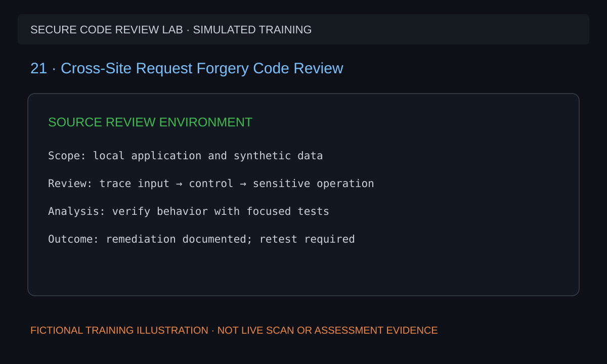

# Project 21: Cross-Site Request Forgery Code Review

**Level:** Intermediate  
**Focus:** CSRF protection  
**Status:** Detailed training walkthrough

## Objective
Review csrf protection implementation paths in source code, verify the security property in a local fixture, and document a safe remediation.

## Scope and authorization
Use fictional code, synthetic values, and repositories you own or are authorized to review. Do not test production or third-party systems without written authorization. All screenshots are simulated illustrations, not real tool output or assessment evidence.

## Prerequisites
- Local application fixture and synthetic test data
- Git, code editor, and relevant runtime
- Semgrep or approved SAST tool
- Unit/integration test harness and framework documentation

## Review methodology
Review local form/API handlers; trace session cookie and state-changing operation; test missing/invalid token and cross-origin simulation in a local harness; enable framework protection and regression tests.

## Detailed review steps
1. Identify entry points, trust boundaries, sensitive operations, and relevant security assumptions.
2. Trace untrusted input and security decisions through middleware, helpers, libraries, and configuration.
3. Verify the relevant control is enforced server-side and fails closed.
4. Inspect alternate paths, error handling, redirects, and framework defaults.
5. Reproduce only with harmless synthetic data in the local fixture.
6. Record affected file/function, data-flow path, preconditions, impact, and confidence.
7. Apply the remediation and inspect the final diff for bypasses and regressions.

## Tools and commands
```bash
grep -RInE 'csrf|xsrf|SameSite|Origin|Referer' samples/
semgrep scan --config auto samples/
git diff --check
```

Static-analysis matches are leads; confirm reachability, runtime behavior, library semantics, and effective configuration manually.

## Expected results
A documented code-path trace, tested positive and negative cases, a confirmed finding or evidence-based no-finding result, and a validated fix.

## Finding and risk analysis
**Representative finding:** A state-changing endpoint relies solely on ambient browser credentials without effective CSRF protection.

**Mapping:** CWE-352; OWASP A01:2021

Assess severity based on exploitability, privileges, data sensitivity, business impact, and compensating controls. Do not assign CVEs to generic patterns.

## Remediation
Use framework CSRF middleware, unpredictable per-session tokens, origin checks as defense in depth, and safe cookie configuration.

## Validation and retesting
1. Add regression tests for allowed and denied cases.
2. Test boundary conditions and alternate code paths.
3. Re-run SAST and manually triage remaining alerts.
4. Run focused tests and inspect the final diff.
5. Record residual risk and reviewer sign-off.

## Evidence and reporting
Include sanitized code excerpts, flow notes, test cases/results, tool versions, severity rationale, remediation diff, and retest status. Never publish secrets, personal data, or production source.

## Simulated screenshots
Fictional instructional mockups only; not real editor captures, scanner output, or live assessment evidence.




## Deliverables
- Scope and review checklist
- Data-flow/security-control notes
- Finding with CWE/OWASP mapping and severity rationale
- Secure change and regression tests
- Retest results and concise report
