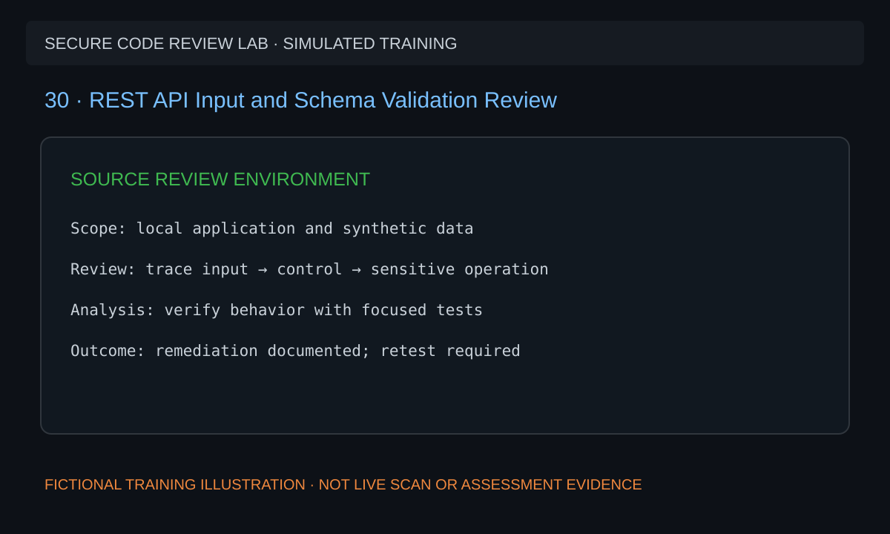
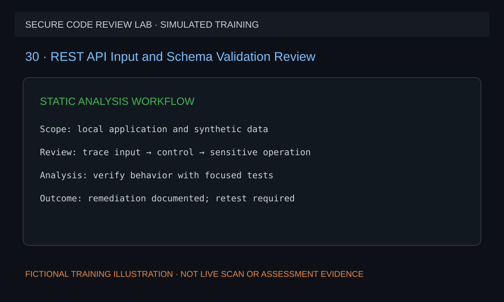
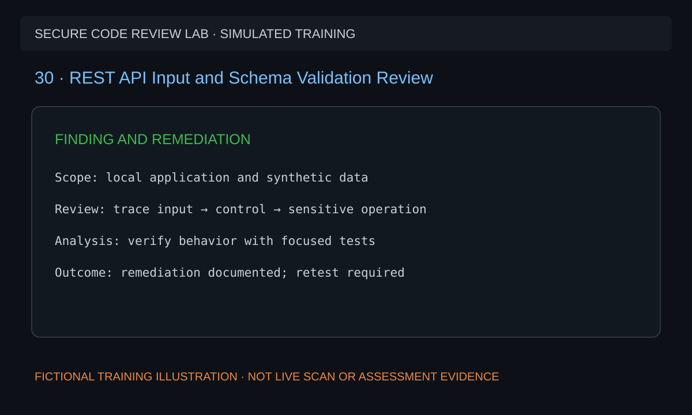

# Project 30: REST API Input and Schema Validation Review

**Level:** Intermediate  
**Focus:** API validation  
**Status:** Detailed training walkthrough

## Objective
Review api validation in application source, trace security-relevant data/control flow, verify behavior in a local fixture, and validate remediation.

## Scope and authorization
Use fictional code and synthetic data in a repository you own or are authorized to review. No production or third-party testing without written authorization. Screenshots are simulated training illustrations, not actual assessment evidence.

## Prerequisites
- Local application fixture with synthetic data
- Git, code editor, and relevant runtime
- Semgrep or approved SAST tool
- Focused unit/integration test harness
- Framework/library documentation

## Review methodology
Create a local API fixture with synthetic records; trace request JSON to model binding; test unexpected/privileged fields; use explicit DTO allowlists and response schemas; add regression tests.

## Detailed review steps
1. Identify entry points, trust boundaries, shared state, and sensitive operations.
2. Trace relevant values through routes, middleware, services, libraries, and configuration.
3. Verify the security control is effective under normal, error, and edge conditions.
4. Inspect alternate code paths and framework defaults.
5. Reproduce only with harmless synthetic values in the local fixture.
6. Record affected file/function, flow, preconditions, impact, and confidence.
7. Apply remediation and inspect the final diff for bypasses or regressions.

## Tools and commands
```bash
grep -RInE 'req\.body|request\.json|DTO|schema|validate|bind\(|mass.?assign' samples/
semgrep scan --config auto samples/
git diff --check
```

SAST output is a lead. Manually confirm reachability, effective runtime configuration, and library behavior.

## Expected results
A documented review trace, tests for relevant positive/negative cases, a confirmed finding or evidence-based no-finding result, and a validated fix.

## Finding and risk analysis
**Representative finding:** Untrusted JSON is bound directly to internal models, allowing clients to set privileged or unintended properties.

**Mapping:** CWE-915; CWE-20; OWASP API3:2023 Broken Object Property Level Authorization

Assess severity based on exploitability, privileges, data sensitivity, business impact, and compensating controls. Do not assign a CVE to a generic code pattern.

## Remediation
Use strict request schemas, allowlisted writable fields, explicit type/range validation, and response DTOs that omit internal properties.

## Validation and retesting
1. Add regression tests for expected and rejected behavior.
2. Exercise edge cases and alternate code paths.
3. Re-run SAST and manually triage remaining matches.
4. Run focused tests and inspect the final diff.
5. Record residual risk and reviewer sign-off.

## Evidence and reporting
Include sanitized code excerpts, flow notes, test cases/results, tool versions, severity rationale, remediation diff, and retest status. Do not publish secrets, personal data, or production source.

## Simulated screenshots
Fictional instructional mockups only; not real editor captures, scanner output, or live assessment evidence.







## Deliverables
- Scope and review checklist
- Data-flow/security-control notes
- Finding with CWE/OWASP mapping and severity rationale
- Secure change and regression tests
- Retest results and concise report
