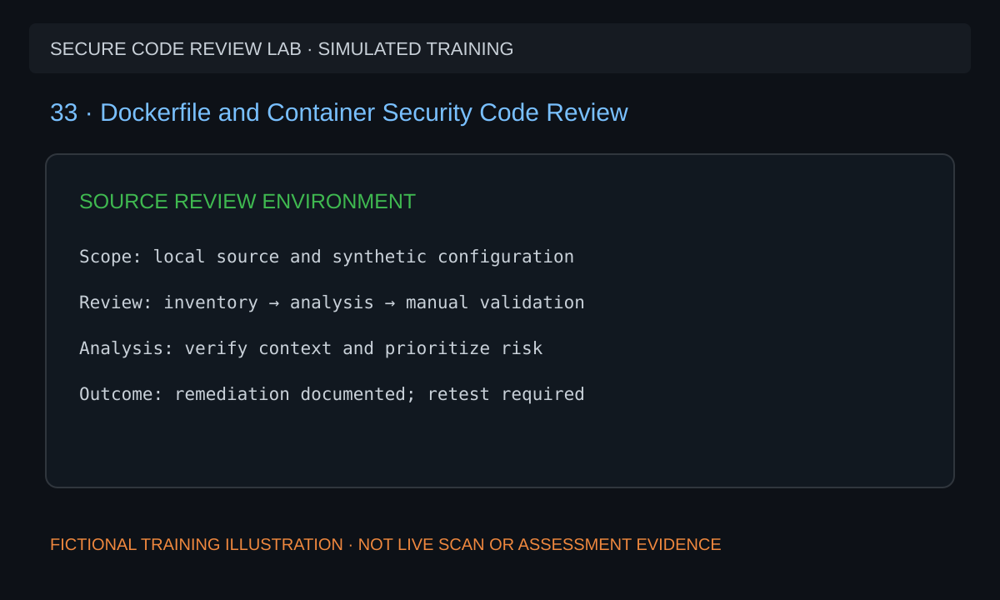
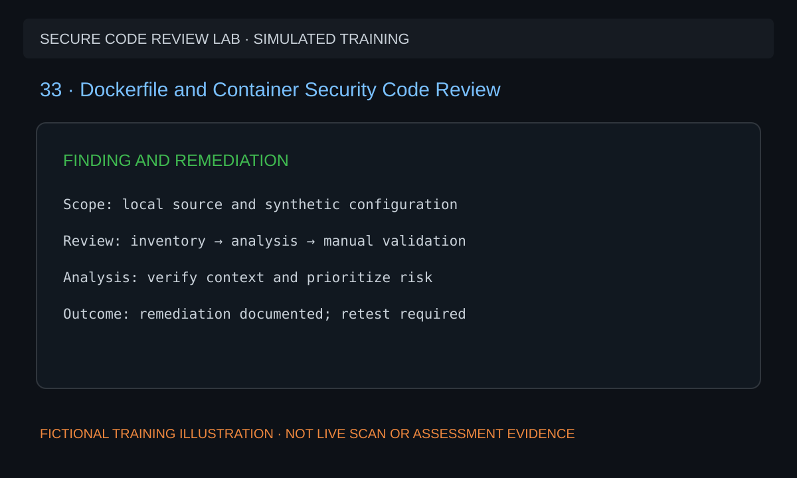

# Project 33: Dockerfile and Container Security Code Review

**Level:** Intermediate  
**Focus:** Container security  
**Status:** Detailed training walkthrough

## Objective
Review container security across the local source repository, validate relevant security controls, and document prioritized remediation.

## Scope and authorization
Use only fictional code, synthetic data, and repositories you own or are authorized to review. No production or third-party testing without written authorization. Screenshots are simulated training illustrations, not real tool output or assessment evidence.

## Prerequisites
- Local source repository and synthetic configuration/data
- Git, code editor, and relevant toolchain
- Semgrep plus project-specific scanner where applicable
- Local test harness and documented review scope

## Review methodology
Review a local Dockerfile fixture; run hadolint and a config scanner where available; inspect build args/layers and runtime user; remediate and verify image configuration using synthetic build data.

## Detailed review steps
1. Define the repository paths, technologies, environments, and exclusions in scope.
2. Identify security-sensitive configuration and data flows.
3. Run appropriate static/configuration checks against local files only.
4. Manually validate each candidate finding, including effective configuration and runtime context.
5. Prioritize by exploitability, exposure, business impact, and compensating controls.
6. Implement remediation in the fixture and add a regression or policy test.
7. Re-run checks and review the final diff.

## Tools and commands
```bash
grep -RInE '^FROM|^USER|ADD |COPY |ENV |ARG |privileged|cap_add' samples/
semgrep scan --config auto samples/
git diff --check
```

Tool findings are leads; verify the exact resource, dependency, code path, or effective setting before reporting.

## Expected results
A sanitized inventory, a prioritized finding register, evidence-backed remediation recommendations, and repeatable validation.

## Finding and risk analysis
**Representative finding:** The image build embeds secrets, runs as root unnecessarily, or uses unpinned/untrusted base images.

**Mapping:** CWE-250; CWE-522; OWASP A05:2021

Severity must reflect context and impact. Avoid overstating risk or mapping generic configuration observations to unrelated CVEs.

## Remediation
Use trusted pinned base images, multi-stage builds, non-root users, minimal packages, secret mounts, read-only filesystems, and least privilege.

## Validation and retesting
1. Re-run the relevant scanner or test after the change.
2. Confirm the unsafe setting or code path is corrected.
3. Run functional tests to check for unintended breakage.
4. Inspect the final diff and record exceptions/residual risk.
5. Obtain owner/reviewer sign-off.

## Evidence and reporting
Include sanitized file paths, relevant excerpts, tool versions, scan configuration, validated findings, severity rationale, remediation diff, and retest status. Do not publish secrets, personal data, or proprietary source.

## Simulated screenshots
Fictional instructional mockups only; not real editor captures, scanner output, or live assessment evidence.






## Deliverables
- Scope and review checklist
- Inventory and security analysis notes
- Finding register with mapping and severity rationale
- Remediation plan and validation tests
- Retest summary and reviewer sign-off
